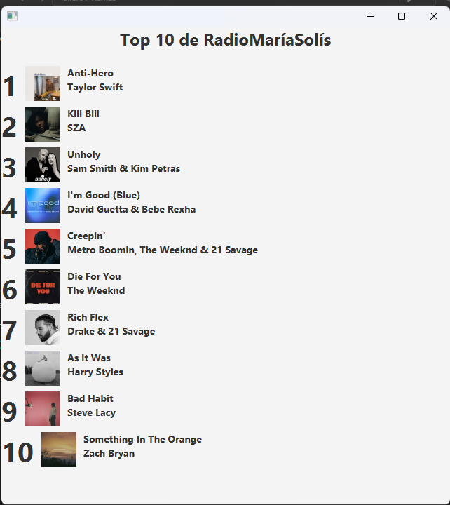

# Taller01-Ramas
Taller01-Ramas
## Cambios de la rama título

## Cambios de la rama orden

## Integrante 3 - Artista

Se modificó el archivo PrimaryController.java para que el nombre del artista o grupo aparezca antes del título de la canción en la lista del Top 10.

Cambio realizado: Se invirtió el orden de los métodos getTitulo() y getCantante() en la presentación de cada canción.

